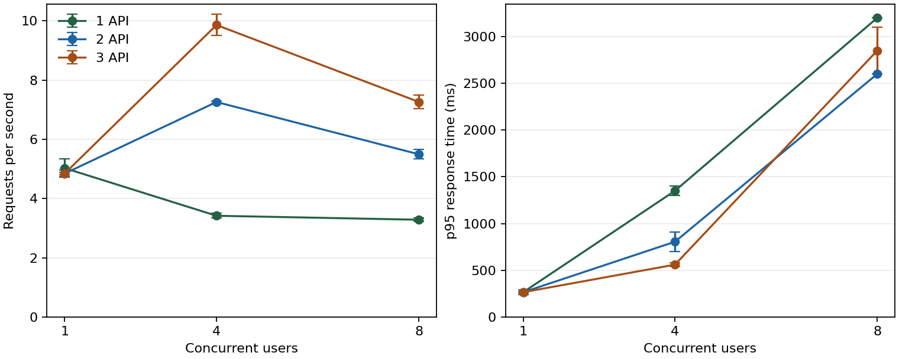

# LeafVision technical guide

Run commands from the repository root. For the shortest path to your first prediction, see the [project README](../README.md#run-locally).

- [Prepare the data](#prepare-the-original-dataset-splits) and [evaluate the model](#evaluate-the-saved-crop-checkpoint)
- [Start the dashboard](#run-the-dashboard-api-and-postgresql-with-docker-compose) and [enable retraining](#retrain-from-the-compose-dashboard)
- [Compare API replicas](#locust-prediction-load-test)
- [Deploy with HTTPS](#cloud-prediction-on-aws) and [review cloud retraining](#cloud-retraining-on-aws)
- [Run the tests](#run-the-tests)

## Run the first prediction

The smoke test was verified on Linux x86-64 with Python 3.12, TensorFlow CPU 2.21.0, and Keras 3.15.1. From the repository root, create a virtual environment with a Python installation that supports `venv` and pip.

```bash
mkdir -p artifacts
python3.12 -m venv .venv
source .venv/bin/activate
python -m pip install -r requirements.txt
```

If Python reports that `ensurepip` is unavailable, create the environment with `python3.12 -m venv --without-pip .venv` and activate it. Download the standalone pip file to `artifacts/pip.pyz` and run `python artifacts/pip.pyz install -r requirements.txt`. [Standalone pip download](https://bootstrap.pypa.io/pip/pip.pyz)

1. For a fresh checkout, run `cp -n models/best_crop_mobilenetv2.keras artifacts/` to put the bundled training checkpoint in the runtime location used by the notebook and worker. Its verified SHA-256 is `9bb1658122b2383ddb111dc35cfdb6b713e92954776ee5e67d0bff899f4b9d21`. [Original crop checkpoint](https://drive.google.com/file/d/1OWsJKf3QXGiB0BsUsXfc-rrh5uELzhp7/view)
2. Put `HL_423.jpg` in `artifacts/`. It is labeled `rice` in the saved test manifest and is stored at `Rice Dataset/Original Dataset/Healthy/HL_423.jpg` inside the original rice archive (about 412 MB). If you already have the extracted dataset, copy that JPEG directly. [Original test manifest](https://drive.google.com/file/d/1V_NOfjpy6nnAT1IolhyoZCweHaflWDiI/view) · [Original rice archive](https://drive.google.com/file/d/1oOVrN9DewTgrQdKqTqje3LLL3I94gp6u/view)

If you have the archive locally, this extracts only the named JPEG.

```bash
unzip -j /path/to/rice_original.zip \
  'Rice Dataset/Original Dataset/Healthy/HL_423.jpg' -d artifacts
```

Run the prediction offline.

```bash
python scripts/smoke_test.py --model artifacts/best_crop_mobilenetv2.keras \
  --image artifacts/HL_423.jpg --expected rice
```

A matching prediction prints `expected=rice predicted=rice` followed by the model score. A label mismatch exits with status 1. You can pass another labeled JPEG and its ground-truth crop using the same arguments.

The shared preprocessing code decodes JPEGs as RGB and resizes them to 128 × 128 using TensorFlow. The model handles normalization internally, so the resized pixel values stay on the 0–255 scale. The smoke test verifies inference on one labeled image. The original notebook documents the earlier test-set evaluation.

## Prepare the original dataset splits

The repository includes the three prepared manifests under `data/`. The JPEGs live in the two source archives. To use the included manifests in a fresh checkout, copy them to the runtime directory expected by the notebook, scripts and Docker worker.

```bash
mkdir -p artifacts/splits
cp -n data/train/train.csv data/validation/val.csv data/test/test.csv artifacts/splits/
```

To reproduce the manifests from their original source instead, download `train.csv`, `val.csv`, and `test.csv` into `artifacts/original-splits/`. Together they are about 4.2 MB. The manifest check runs with standard Python 3.12 and requires only these CSVs. [Original split manifests](https://drive.google.com/drive/folders/1YJsEbynQrchzlOGAt_sSXLElSTpkXrjA)

```bash
python scripts/prepare_splits.py
```

The three output CSVs in `artifacts/splits/` keep the original filenames, row order, crop labels, and health metadata. Each path is relative to a dataset root containing `ccmt/` and `rice/`. For example, `/content/work/rice/Rice Dataset/Original Dataset/Healthy/HL_423.jpg` becomes `rice/Rice Dataset/Original Dataset/Healthy/HL_423.jpg`.

The script reports crop counts and fails on invalid labels or repeated paths within or across splits. An identical rerun reuses the outputs. For another manifest version, pass `--input-dir` and `--output-dir` to keep both versions available.

| Original split | Cashew | Cassava | Maize | Rice | Tomato | Total |
| --- | ---: | ---: | ---: | ---: | ---: | ---: |
| Train | 4,585 | 5,255 | 3,700 | 1,927 | 4,046 | 19,513 |
| Validation | 982 | 1,127 | 798 | 412 | 866 | 4,185 |
| Test | 982 | 1,126 | 790 | 414 | 867 | 4,179 |

All 27,877 image paths were unique in the manifest audit.

## Check image contents for duplicates

Place `ccmt_raw.zip` and `rice_original.zip` in `artifacts/archives/` alongside the prepared manifests in `artifacts/splits/`. The archives total about 1.75 GB. The audit reads each listed image directly from its ZIP. [CCMT archive](https://drive.google.com/file/d/1gkWaLaWJWIP9-wkSAAjhwAUAyZT4R8n1/view) · [Rice archive](https://drive.google.com/file/d/1oOVrN9DewTgrQdKqTqje3LLL3I94gp6u/view)

```bash
python scripts/audit_image_hashes.py
```

The report at `artifacts/image-hash-audit.json` groups byte-identical files by SHA-256 and lists each member's split, path, and crop. Exit status 0 means all digest groups are confined to individual splits. Status 1 means the completed audit found a digest in multiple splits. Status 2 means the audit could not finish. Detecting resized, recompressed, or visually similar leaves requires a separate check.

The original split audit hashed 27,877 images and found 27,010 distinct byte sequences. Of 864 duplicate groups, 421 crossed split boundaries. Training shared 191 groups with test and 184 with validation. Another 46 groups appeared in both validation and test. All copies within each group had the same crop label.

Of the 4,179 original test images, 191 (4.57%) had a byte-identical training copy.

## Evaluate the saved crop checkpoint

With the checkpoint, archives, and portable manifests in the locations above, run the evaluator.

```bash
python scripts/evaluate_crop.py
```

The evaluator recomputes SHA-256 groups, excludes test hashes found in training or validation, and keeps the first manifest row for each remaining hash. It runs the frozen model once per original test image. Both evaluations use those predictions, the notebook's crop order, and the same RGB preprocessing.

`artifacts/crop-evaluation.json` records the checkpoint checksum, runtime versions, per-image predictions and exclusions, class counts, and both confusion matrices (rows are actual crops, columns are predictions). Macro metrics weight the five crops equally. Loss is mean cross-entropy calculated from the true class probability with a floor of `1e-7`.

| Test set | Correct / total | Accuracy | Macro precision | Macro recall | Macro F1 | Loss |
| --- | ---: | ---: | ---: | ---: | ---: | ---: |
| Original | 4,135 / 4,179 | 98.947% | 0.98987 | 0.99158 | 0.99067 | 0.04236 |
| SHA-256 filtered | 3,883 / 3,926 | 98.905% | 0.98942 | 0.99125 | 0.99028 | 0.04485 |

Filtering removed 237 test rows shared with training or validation and 16 additional test copies. The retained set contains 982 cashew, 1,086 cassava, 719 maize, 405 rice, and 734 tomato images. Accuracy fell by 0.042 percentage points. Of the 43 remaining errors, 29 were on cassava images. These scores describe the original source datasets after exact-byte filtering. Visually similar photos can still cross splits.

## Screen for visually similar photos across splits

```bash
python scripts/audit_similar_images.py
```

The audit applies EXIF orientation, converts each image to grayscale, and compares neighboring pixels on a 9 × 8 thumbnail. These comparisons produce a 64-bit difference hash (dHash). For each pair of splits, the script lists every pair with different SHA-256 digests and a dHash distance of at most four bits. This is a screening threshold. Visually similar backgrounds can produce matches, and a crop or rotation can move a related image outside the threshold.

`artifacts/similarity/pairs.json` contains pair counts, paths, crops, and distances. `review.jpg` in the same folder shows the first, middle, and last candidates in each split comparison, ordered by distance and then path. Each row shows the two splits in left-to-right order. This selection illustrates the range of matches and cannot estimate the proportion of true duplicates.

| Split comparison | Candidate pairs with different file bytes | Byte-identical pairs |
| --- | ---: | ---: |
| Train and validation | 1,121 | 185 |
| Train and test | 1,242 | 191 |
| Validation and test | 248 | 46 |

The counts cover all 27,877 images. One image can occur in several pairs. Re-encoding the known rice test photo `HL_423.jpg` at JPEG qualities 85, 65, and 40 changed its SHA-256 each time and preserved its dHash.

| Review row | Visual assessment | Evidence in the paired images |
| ---: | --- | --- |
| 1 | Likely same photograph | Cassava leaf folds, brown stem, and cast shadow line up. |
| 2 | Likely different | The rice blade on the right has dark oval lesions absent from the left. |
| 3 | Inconclusive | Both blades form a similar diagonal against white. Few interior details can be matched. |
| 4 | Likely same photograph | The cashew leaf veins, damaged patch by the midrib, and background line up. |
| 5 | Likely different | The left blade has a notch in its edge. The right blade tapers smoothly. |
| 6 | Inconclusive | Two narrow blades share an outline with few distinctive markings. |
| 7 | Likely same photograph | The cassava leaf holes, dark spots, and background align. |
| 8 | Likely different | The left blade has two prominent dark lesions. The right blade has longitudinal streaks. |
| 9 | Likely different | The left blade has a broad, striped surface. The right one has a narrower, tapered end. |

The test images in rows 4 and 7 were both retained in the SHA-256-filtered evaluation. They appear to match a training and a validation photograph, respectively. The 98.905% result therefore still has a visual-overlap limitation.

### Review training matches among retained test images

`python scripts/review_train_test.py` reproduces the contact sheet and sensitivity calculation in `artifacts/similarity/train-test/`. Of the 3,926 test images retained after SHA-256 filtering, 286 had at least one perceptual match in training, for 1,198 candidate pairs. The visual review covered all ten zero-distance pairs with a non-rice test image, plus the middle pair in each remaining crop-group and distance combination, using rice and the other crops as the two groups.

Of the 19 reviewed pairs, 14 looked like the same photograph, three looked different, and two were inconclusive. The 14 likely matches involved 13 distinct test images. Excluding those 13 from the saved predictions gives **98.901% (3,870 of 3,913)**, compared with **98.905% (3,883 of 3,926)** for the full SHA-256-filtered subset. The sensitivity result covers the visually reviewed exclusions. Use the SHA-256-filtered result as the reproducible baseline and report it alongside the visual-overlap finding. [Pair-level review decisions](train-test-review.json)

## Explore the training images

```bash
python scripts/explore_training_images.py
```

The script reads the original training manifest and archives, keeps the first file for each SHA-256 hash, applies EXIF orientation, and resizes each RGB image to 128 × 128 with bilinear interpolation. Brightness is mean grayscale intensity. Green dominance is the mean pixelwise difference between green and the larger of red and blue. Edge density is the percentage of interior pixels whose grayscale difference from the right or bottom neighbor is at least 24 on a 0–255 scale.

The three box plots in `artifacts/training-features/` show crop counts, medians, middle 50% ranges, and 10th to 90th percentile whiskers. The directory also contains per-image features, a summary with original dimensions and near-white pixel percentages, and an example image closest to the median brightness for each crop.

| Crop | Unique training images | Median brightness | Median green dominance | Median edge density |
| --- | ---: | ---: | ---: | ---: |
| Cashew | 4,584 | 131.2 | +6.0 | 6.08% |
| Cassava | 5,201 | 132.4 | +13.5 | 6.77% |
| Maize | 3,579 | 126.2 | +15.6 | 5.57% |
| Rice | 1,912 | 228.1 | +0.7 | 3.39% |
| Tomato | 3,829 | 132.3 | −6.3 | 5.19% |

**Brightness.** Rice had a median brightness of 228.1 out of 255, while the other crops ranged from 126.2 to 132.4. The median rice image was 82.7% near-white pixels, using a threshold of 245 in all three channels. All four other crops had a median of 0%. Rice also came from a separate source and had a median original resolution of 1,944 × 1,944 pixels. The other crops had median dimensions of 400 × 400. These differences make image source and background plausible cues for rice classification.

**Green dominance.** Maize and cassava had the highest medians at +15.6 and +13.5, with substantial overlap between their distributions. Tomato had a median of −6.3. This feature measures the entire frame, so lighting, background, and diseased tissue all contribute to the observed crop differences.

**Edge density.** Rice had the lowest median at 3.39%, with a 10th to 90th percentile range of 2.91% to 4.63%. Maize ranged from 1.54% to 14.72%. Large uniform backgrounds can dilute the rice score, while the maize spread suggests substantial variation in image content or framing. The fixed resizing and threshold make this an image-level texture heuristic.

## Run the baseline notebook

The notebook plots the historical MobileNetV2 training losses, checks a labeled image from the original rice archive, and reruns the evaluation on both test subsets. Use the checkpoint, archives, and prepared splits listed above. [LeafVision notebook](../notebook/leafvision_mlops.ipynb)

From the repository root with the project environment active, install the notebook runner and execute the notebook.

```bash
python -m pip install nbclient==0.10.2 ipykernel==6.29.5
mkdir -p artifacts/notebooks
jupyter-execute --timeout=1200 \
  --output=../artifacts/notebooks/leafvision_mlops.executed \
  notebook/leafvision_mlops.ipynb
```

The executed copy includes the prediction, metric table, and confusion matrix. It checks the checkpoint against the expected correct and total counts for both subsets.

## Export the crop checkpoint as HDF5

With the original Keras checkpoint, portable test manifest, and archives in place, run:

```bash
python scripts/export_crop_model.py
```

The exporter reloads the HDF5 model and checks both formats on the same preprocessed test batches. It verifies the input and output shapes, the top crop on every image, and all five scores per image within an absolute tolerance of `1e-7` and a relative tolerance of `1e-6`. A passing run publishes `models/crop_model_v1.h5` and writes both file checksums and the comparison to `artifacts/crop-export-parity.json`. The HDF5 file contains the model architecture and weights for inference. The original Keras checkpoint remains the source for future fine-tuning.

The verified export matched all five scores and the predicted crop for each of the 4,179 original test images. Both models classified 4,135 images correctly (98.947%). The HDF5 file reloaded successfully in a separate process and passed the labeled rice smoke test.

## Run the local prediction API

From the repository root with the project environment active, install `requirements.txt` and start the API.

```bash
python -m uvicorn src.api.main:app --host 127.0.0.1 --port 8000
```

The default serving baseline is `models/crop_model_v1.h5`. Set `LEAFVISION_MODEL_PATH` to use a different verified baseline when initializing a deployment. The API loads its active model at startup and caches it for inference. If loading or signature validation fails, startup fails.

```bash
curl --fail-with-body http://127.0.0.1:8000/health
curl --fail-with-body http://127.0.0.1:8000/model/info
curl --fail-with-body -F 'file=@artifacts/HL_423.jpg' http://127.0.0.1:8000/predict
```

`POST /predict` expects a JPEG in the multipart field `file`. It returns the crop, model score, checkpoint filename stem, and processing time in milliseconds. The verified rice example returns `rice` with a score of approximately `0.99999988`. Invalid or missing JPEG input returns HTTP 422. Files above 5 MiB or 20 million pixels return HTTP 413.

## Run the prediction API in Docker

From the repository root on a Linux x86-64 Docker host, build the API image. The first build downloads the Python base image and the CPU TensorFlow dependencies. The image includes the verified `crop_model_v1.h5` and starts in prediction-only mode by default.

```bash
docker build -f Dockerfile.api -t leafvision-api:local .
docker run --detach --rm --name leafvision-api-smoke \
  --publish 127.0.0.1:18000:8000 leafvision-api:local
```

Port 18000 lets the container run alongside the local development API on port 8000. Allow time for the model to load, then check readiness, model version and the labeled rice photo prepared above.

```bash
curl --fail --retry 30 --retry-connrefused --retry-delay 2 http://127.0.0.1:18000/health
curl --fail-with-body http://127.0.0.1:18000/model/info
curl --fail-with-body -F 'file=@artifacts/HL_423.jpg' http://127.0.0.1:18000/predict
docker stop leafvision-api-smoke
```

In the Linux x86-64 smoke test, both the container and the local API returned `rice` with score `0.9999998807907104` from `crop_model_v1`. The container also passed its readiness check and returned HTTP 422 for invalid JPEG bytes. It runs as user `leafvision`. The upload database, retraining archives and dashboard run separately.

## Run the dashboard, API and PostgreSQL with Docker Compose

Compose reads `LEAFVISION_DB_PASSWORD` and `LEAFVISION_OPERATOR_TOKEN` from the Git-ignored `.env` file. For a fresh checkout, create both secrets from the repository root. An existing installation can add the operator token to its current file and keep its database password.

```bash
(umask 077; set -C; python3 -c 'import secrets; print("LEAFVISION_DB_PASSWORD=" + secrets.token_hex(32)); print("LEAFVISION_OPERATOR_TOKEN=" + secrets.token_hex(32))' > .env)
docker compose up --build --detach --wait
curl --fail http://127.0.0.1:18000/data/summary
```

Visitors can predict and view results. Enter the configured **Operator token** in the dashboard sidebar to save labeled photos, start retraining, promote a candidate, or restore the baseline. Clear the field to sign out. The API verifies the bearer token on every write. A missing or incorrect credential receives HTTP 401. If the API has no configured token, operator access is disabled (HTTP 503). Use HTTPS before entering a token on a public deployment.

For the command-line examples below, load the generated settings in your shell with `source .env`. For a standalone API process, also run `export LEAFVISION_OPERATOR_TOKEN` before starting Uvicorn. To rotate access, replace the token in the file and recreate all API replicas with the new setting.

Open the dashboard, select `artifacts/HL_423.jpg` and click **Identify crop**. The expected crop is rice. To save a batch, open **Labeled uploads**, select **Tomato**, choose two distinct labeled tomato JPEGs and click **Save labeled batch**. The page shows the batch ID and updated counts. [Open the Compose dashboard](http://127.0.0.1:18501)

Compose starts PostgreSQL, the API, HAProxy and Streamlit in order, waiting for each dependency's health check. The dashboard connects to `http://proxy:8000` inside the Compose network. The dashboard and proxy publish loopback ports 18501 and 18000 respectively. To change them, set `LEAFVISION_UI_PORT` or `LEAFVISION_API_PORT` in `.env`. PostgreSQL and individual API containers are reachable only inside the Compose network.

The `database` volume holds the batch and image records. The `api_files` volume holds the uploaded JPEGs. For PostgreSQL 18 the database mount point is `/var/lib/postgresql`. [PostgreSQL image storage documentation](https://github.com/docker-library/docs/blob/master/postgres/README.md#pgdata)

To check persistence for a batch saved through the dashboard, copy its batch ID, recreate the services with the command below, and fetch the batch. To create the batch from the command line instead, use the example upload with two previously unused photos.

```bash
curl --fail-with-body -H "Authorization: Bearer ${LEAFVISION_OPERATOR_TOKEN}" -F crop=tomato \
  -F files=@artifacts/retraining-inputs/tomato-259.jpg \
  -F files=@artifacts/retraining-inputs/tomato-308.jpg \
  http://127.0.0.1:18000/data/upload
docker compose up --detach --force-recreate --wait
curl --fail "http://127.0.0.1:18000/data/batches/<batch-id>"
```

In the local recreation test, the API returned HTTP 201 for tomato batch `199f9ce2-9f66-4ba0-a409-5406b7bc02da`. After both container IDs changed, the batch lookup returned the same timestamp and two image records. A direct SQL query recovered both rows, and the JPEGs read from their stored paths matched the original files by size (15,646 and 18,557 bytes) and SHA-256.

In a separate Compose run, Streamlit's widget test runner exercised both forms inside the dashboard container against the live API. **Identify crop** returned **Rice**, score `0.99999988`, from `crop_model_v1`. **Save labeled batch** returned `10e1361c-69fb-495a-abff-74ae8d382053` and showed one batch with two images. A direct PostgreSQL query found both tomato image records under that ID.

`docker compose down` stops the services and preserves both volumes for the next start.

### Retrain from the Compose dashboard

Enable the `training` profile to add the worker. It reuses the API image and reads jobs from the same PostgreSQL database. Prepare these original training inputs before starting it.

- `artifacts/best_crop_mobilenetv2.keras`, the verified custom crop checkpoint. [Copy the bundled checkpoint](#run-the-first-prediction).
- `artifacts/archives/ccmt_raw.zip` and `artifacts/archives/rice_original.zip`, containing the original images. [Get the source archives](#check-image-contents-for-duplicates).
- `artifacts/splits/train.csv`, `val.csv` and `test.csv`, the portable manifests used to exclude duplicates and keep test examples out of training and validation. [Copy the included manifests](#prepare-the-original-dataset-splits).

```bash
docker compose --profile training up --build --detach --wait
```

In **Labeled uploads**, save a batch of new photos with a verified crop label. In **Retraining**, select its batch ID and click **Retrain**. When validation finishes, compare the baseline and candidate metrics and check the serving version shown above them. [Open retraining in Compose](http://127.0.0.1:18501/retraining)

The worker mounts the original inputs read-only. The shared `api_files` volume holds the uploaded photos, candidate and report, so the API can read a completed model after the worker exits. To copy a run to a new local directory, substitute the job ID shown in the dashboard. Stop the stack with the same profile to include the worker.

```bash
JOB_ID='replace-with-dashboard-job-id'
docker compose cp "api:/app/artifacts/retraining/$JOB_ID" "./$JOB_ID"
docker compose --profile training down
```

In the Compose run `7ea0b21d-b4e2-443c-91bf-6b513c1d35b5`, the Streamlit **Retrain** control queued a two-photo tomato batch. The worker fine-tuned the custom checkpoint on those photos and 100 original training photos. On 3,933 fixed validation photos, correct predictions rose from 3,900 to 3,902, macro F1 from 0.99268 to 0.99306, and cross-entropy loss fell from 0.02906 to 0.02785. Reloading `candidate.keras` reproduced every validation score exactly. The dashboard showed the finished job and `crop_model_v1` as the serving version.

### Check routing across one, two and three API containers

HAProxy discovers API addresses through Compose DNS. It checks each replica's `/health` endpoint, distributes requests round-robin across ready replicas, and adds its backend slot name to the `X-LeafVision-Replica` response header. The three configured slots cover the assignment's scaling study. Each API reads the active model version from the shared PostgreSQL database and loads the corresponding model from shared storage or its packaged baseline. [HAProxy configuration reference](https://docs.haproxy.org/3.2/configuration.html)

With the project Python environment active and the baseline serving, run this from the repository root. Each check sends three predictions per configured replica through the same proxy address and verifies the crop, model version, score consistency and number of distinct backends. Set `--url` if you changed the published port.

```bash
(
  set -e
  for replicas in 1 2 3; do
    docker compose up --detach --wait --scale "api=$replicas"
    python scripts/check_replica_routing.py --replicas "$replicas"
  done
)
```

To check a promotion, keep three replicas running and use **Promote candidate** in the dashboard for an eligible completed job. Repeat the script with `--replicas 3 --version "$JOB_ID"`. After **Restore baseline**, run it again with `--replicas 3`. For a labeled photo other than the default rice example, supply both `--image` and `--crop`. Monitoring counters belong to the replica that handled each summary request.

The local verification used `tomato-308.jpg` from the labeled upload batch to make the model switch observable. Every request went through port 18000 and returned `tomato`. The API container logs independently confirmed 36 successful predictions across the five checks.

| API containers | Serving state | Predictions by backend slot (api1 / api2 / api3) | Tomato score |
|---:|---|---|---:|
| 1 | Baseline | 3 / – / – | 0.927661240 |
| 2 | Baseline | 3 / 3 / – | 0.927661240 |
| 3 | Baseline | 4 / 2 / 3 | 0.927661240 |
| 3 | Promoted `7ea0b21d-b4e2-443c-91bf-6b513c1d35b5` | 3 / 3 / 3 | 0.951961339 |
| 3 | Restored baseline | 3 / 3 / 3 | 0.927661240 |

## Locust prediction load test

On 23 November 2026, all **3,103 measured predictions** returned HTTP 200, the expected rice label and score, the baseline model version and a backend identifier. Each active API replica handled successful predictions in every trial. The highest combined throughput was **9.86 requests/s with three API containers and four users**.

Locust 2.47.0 sent the same 486,732-byte labeled JPEG (`artifacts/HL_423.jpg`) through HAProxy to `POST /predict` with no pause between responses and the next upload. The generator, PostgreSQL, proxy and API containers shared one Zorin OS 18.1 laptop with an Intel Core i5-8250U (4 physical cores, 8 logical CPUs) and 7.65 GiB RAM. Every API container used one Uvicorn process and two TensorFlow intra-op and inter-op threads. The isolated stack used `crop_model_v1` and ran inference throughout.

Each combination had two 30-second runs, each preceded by a separate five-second warm-up at the same concurrency. The table combines completed requests and divides by the sum of the two Locust measurement intervals for requests/s. Mean latency is weighted by request count. Median and p95 are the client-observed Locust values for trial 1 / trial 2. Warm-ups are excluded.

| API containers | Users | Requests | Failures | Requests/s | Mean (ms) | Median (ms) | p95 (ms) |
|---:|---:|---:|---:|---:|---:|---:|---:|
| 1 | 1 | 300 | 0 | 5.03 | 199 | 180 / 200 | 260 / 270 |
| 1 | 4 | 206 | 0 | 3.42 | 1,166 | 1,100 / 1,200 | 1,300 / 1,400 |
| 1 | 8 | 204 | 0 | 3.28 | 2,409 | 2,300 / 2,400 | 3,200 / 3,200 |
| 2 | 1 | 289 | 0 | 4.85 | 206 | 200 / 200 | 240 / 290 |
| 2 | 4 | 437 | 0 | 7.26 | 548 | 530 / 530 | 700 / 910 |
| 2 | 8 | 340 | 0 | 5.49 | 1,437 | 1,500 / 1,400 | 2,600 / 2,600 |
| 3 | 1 | 290 | 0 | 4.85 | 206 | 200 / 200 | 270 / 260 |
| 3 | 4 | 591 | 0 | 9.86 | 404 | 400 / 370 | 580 / 540 |
| 3 | 8 | 446 | 0 | 7.26 | 1,087 | 430 / 390 | 3,100 / 2,600 |

At four users, going from one to three API containers nearly tripled throughput and cut mean latency from 1,166 to 404 ms. At eight users, the third container increased throughput over two containers, while p95 was 3.1 and 2.6 seconds versus 2.6 seconds in both two-container runs. Adding replicas also used more RAM. The peak sampled combined API working set at eight users rose from 729 MiB with one container to 1,603 MiB with three. These short runs used one repeated photo on a shared laptop. Public network latency, other photos and cloud hardware can change the result.



[Reproduce the benchmark](../load_testing/README.md) · [All 18 trials, including p99, CPU and memory](../load_testing/results/2026-11-23-local/trials.csv)

## Use the crop prediction dashboard

Keep the local prediction API running. From the repository root with the project environment active, start the dashboard in a second terminal.

```bash
python -m streamlit run frontend/app.py --server.address 127.0.0.1 --server.port 8501
```

Open the local dashboard, select one JPEG, and click **Identify crop**. The result shows the leaf photo, predicted crop, model score, and the version that served the request. To reproduce the rice example, select `artifacts/HL_423.jpg` from the first prediction exercise. The dashboard calls `http://127.0.0.1:8000` by default. Set `LEAFVISION_API_URL` in the dashboard terminal to use another API address. [Open the local dashboard](http://127.0.0.1:8501)

Choose **Dataset insights** in the top navigation to compare brightness, green dominance, and edge density across crops. Hover over a range or median to see its values and sample size. The charts describe 19,105 distinct images in the original training split. They use a packaged copy of the measured summary and work independently of the prediction API. [Open dataset insights](http://127.0.0.1:8501/dataset-insights)

To refresh the snapshot after rerunning `scripts/explore_training_images.py`, copy `artifacts/training-features/summary.json` to `frontend/data/training-summary.json` and review each interpretation against the new data.

## Monitor prediction traffic

Open **Monitoring** to see the API process uptime, serving model version, prediction request count and failed requests. The screen refreshes every five seconds using `GET /monitoring/summary`. Each API process starts its own counters at startup. [Open monitoring](http://127.0.0.1:8501/monitoring)

Only `POST /predict` contributes to the counts. HTTP 4xx and 5xx responses count as failures, including invalid uploads. The table keeps the ten most recent failures with their UTC timestamps and HTTP status. Mean and nearest-rank p95 latency use the latest 100 successful predictions, measured inside the server from request handling through response sending. The latency panel shows its sample count and stays empty until a prediction succeeds.

## Store labeled training images

Create an empty PostgreSQL database for LeafVision, then set `LEAFVISION_DATABASE_URL` to the connection string for a role that can create tables and indexes in that database. Start the API as above. It creates the upload schema at startup and saves JPEGs under `artifacts/uploads/` by default. Set `LEAFVISION_UPLOAD_ROOT` to use a different persistent directory. Keep the database and upload directory together when backing up or moving the service.

In **Labeled uploads**, choose the verified crop shared by the photos, select up to 10 JPEGs, and click **Save labeled batch**. The receipt shows the batch ID, crop and accepted image count. **Saved uploads** reads the totals for all five crops from PostgreSQL. **Refresh counts** updates those totals without submitting the files again. [Open labeled uploads](http://127.0.0.1:8501/labeled-uploads)

```bash
curl --fail-with-body -H "Authorization: Bearer ${LEAFVISION_OPERATOR_TOKEN}" \
  -F 'crop=rice' \
  -F 'files=@/path/to/first-labeled-leaf.jpg' \
  -F 'files=@/path/to/second-labeled-leaf.jpg' \
  http://127.0.0.1:8000/data/upload

curl --fail-with-body "http://127.0.0.1:8000/data/batches/${BATCH_ID}"
curl --fail-with-body http://127.0.0.1:8000/data/summary
```

Replace `BATCH_ID` with the UUID returned by the upload. One request accepts up to 10 JPEGs for a single crop, each up to 5 MiB and 20 million pixels. Use new labeled photos that are separate from the evaluation set. The batch lookup returns the crop and each file's SHA-256, size, and path relative to the upload root.

An invalid crop or JPEG returns HTTP 422. A repeated SHA-256 within the batch or across previous batches returns HTTP 409. Both reject the entire batch. Interrupted commits can leave a directory on disk whose database outcome needs to be checked. When no database is configured, the upload routes return HTTP 503 and local prediction stays available.

`GET /data/summary` counts accepted labeled uploads recorded in PostgreSQL. It returns `total_batches`, `total_images`, and `images_by_crop` with all five crop labels. A crop with no uploads has a count of zero. Rejected batches do not affect the totals.

## Retrain the crop classifier locally

Upload a batch with a verified crop label and use its returned UUID below. Run from the repository root with the same database URL and upload directory as the API. The command also needs the original Keras checkpoint, prepared split manifests and both ZIP archives described above.

```bash
python -m src.retraining --batch-id "${BATCH_ID}"
```

The script checks the stored upload hashes against every original split and verifies the image bytes as it reads them. It samples 20 distinct training photos per crop with seed 42, adds the upload batch, and trains the existing five-class output layer for one epoch with Adam at a learning rate of 0.0001. Freezing the MobileNetV2 backbone keeps this first CPU run small.

Both models are evaluated on every distinct validation hash exclusive to that split. The original training sample also uses split-exclusive hashes. Exact-byte filtering can miss visually similar photos. Test images contribute hashes for overlap checks only.

The command prints a new directory under `artifacts/retraining/`. Its `report.json` records the training and validation image paths and hashes, checkpoint and candidate checksums, training settings, confusion matrices, five metrics, and the maximum change in prediction scores after reload. The directory and `candidate.keras` become available together after verification. Serving continues to use the configured checkpoint.

For the first run, two source-labeled tomato JPEGs from Mohanty, Hughes and Salathé’s PlantVillage collection went through `POST /data/upload` as one batch. The recorded SHA-256 digests begin with `a294299b0518` and `a0d4ca4c979a`, respectively. [Tomato leaf 259.1](https://raw.githubusercontent.com/spMohanty/PlantVillage-Dataset/master/raw/color/Tomato___healthy/000146ff-92a4-4db6-90ad-8fce2ae4fddd___GH_HL%20Leaf%20259.1.JPG) · [Tomato leaf 308.1](https://raw.githubusercontent.com/spMohanty/PlantVillage-Dataset/master/raw/color/Tomato___healthy/000bf685-b305-408b-91f4-37030f8e62db___GH_HL%20Leaf%20308.1.JPG)

The first run used 102 training photos and 3,933 validation photos. After reload, the largest absolute difference across all candidate validation scores was zero.

| Validation metric | Original checkpoint | Candidate |
| --- | ---: | ---: |
| Correct predictions | 3,900 | 3,902 |
| Accuracy | 99.161% | 99.212% |
| Macro precision | 0.99208 | 0.99248 |
| Macro recall | 0.99332 | 0.99367 |
| Macro F1 | 0.99268 | 0.99306 |
| Mean cross-entropy loss | 0.02906 | 0.02785 |

## Start and follow a background retraining job

Run the local API and start the worker in a second terminal from the same checkout. Both processes need the same `LEAFVISION_DATABASE_URL` and upload directory. The worker needs the checkpoint, archives and manifests listed above. PostgreSQL stores the queue and job results.

```bash
python -m src.worker
```

With the worker running, open **Retraining** and choose a saved batch by crop, image count and ID. Click **Retrain** once. The page displays the job ID and checks for progress every three seconds while the job is queued or running. On completion it shows the candidate version, the currently serving version and five validation metrics side by side. A failed job shows the worker’s error. Returning to a batch reopens its latest job. [Open retraining](http://127.0.0.1:8501/retraining)

Submit the UUID returned by a successful labeled upload.

```bash
curl --fail-with-body -H "Authorization: Bearer ${LEAFVISION_OPERATOR_TOKEN}" -i -H 'Content-Type: application/json' \
  -d "{\"batch_id\":\"${BATCH_ID}\"}" http://127.0.0.1:8000/train/retrain
```

The API returns HTTP 202 with a `job_id` and a `Location` header. Poll that location for the current status.

```bash
curl --fail-with-body "http://127.0.0.1:8000/train/jobs/${JOB_ID}"
```

Requests wait in `queued` until a worker is available. A `running` job reports its stage as `preparing_data`, `training` or `validating`. A `succeeded` job includes baseline and candidate validation metrics, the candidate checksum and its version under `artifacts/retraining/<job_id>/`. A `failed` job includes an error. Predictions continue using the configured serving model throughout.

Repeated requests for the same batch share one job while it is queued or running. Workers take a PostgreSQL session lock so only one trains at a time. Restarting a worker resumes an interrupted job by checking for its published candidate and report, or by restarting the epoch if publication had not finished. Use `python -m src.worker --once` to process at most one job.

## Promote a candidate and roll back

On **Retraining**, select the batch and review its latest completed job. Click **Promote candidate** below the validation table to switch predictions. The page reads back the serving version and displays the API’s reason for any rejected switch. While a candidate is serving, **Restore baseline** switches back to the registered baseline even if you are viewing another batch. [Open retraining](http://127.0.0.1:8501/retraining)

Promotion is an explicit local API action after a successful training job. The trial rule requires higher validation macro F1, equal or higher accuracy, and equal or lower mean cross-entropy on the same validation images. The API checks that the job evaluated the current serving checkpoint, verifies the candidate checksum, and loads the model before committing the switch. The original Keras checkpoint and its verified HDF5 export count as the same baseline. A worker starting another job after promotion trains from the active candidate.

Read the current version from `GET /model/info`. Supply it as `expected_active` when promoting a job or rolling back to the registered baseline. A stale version, failed validation gate or artifact mismatch returns HTTP 409 and preserves the active selection.

```bash
curl --fail-with-body -H "Authorization: Bearer ${LEAFVISION_OPERATOR_TOKEN}" -H 'Content-Type: application/json' \
  -d '{"expected_active":"crop_model_v1"}' \
  "http://127.0.0.1:8000/model/versions/${JOB_ID}/promote"

curl --fail-with-body -H "Authorization: Bearer ${LEAFVISION_OPERATOR_TOKEN}" -H 'Content-Type: application/json' \
  -d "{\"expected_active\":\"${JOB_ID}\"}" http://127.0.0.1:8000/model/rollback
```

All API processes share the database and model directories. Each prediction reads the active version and keeps a reference to that model through the response. In the two-process check, both classified the same tomato JPEG with a score of 0.927661 on the baseline, 0.951961 on the candidate, and 0.927661 after rollback. These matched direct inference on the two artifacts. The photo came from the retraining batch and served as a version-switch check. The independent quality comparison used the 3,933 validation photos above.

## Cloud prediction on AWS

On November 26, 2026, a browser opened the public HTTPS dashboard in Stockholm, uploaded `HL_423.jpg` and clicked **Identify crop**. The test manifest labels this photograph as rice. Model `crop_model_v1` returned **Rice** with a score of **0.99999988**. The API recorded one prediction, zero failures and **241.3 ms** of server-side request time. The run verifies a single labeled example. Use the notebook for held-out classification metrics and the Locust study for performance under load. [Dashboard screenshot](evaluation/aws-rice-prediction.png) · [API monitoring response](evaluation/aws-prediction-monitoring.json)

After the test, EC2 confirmed instance termination, deletion of the dedicated security group, and zero remaining tagged demo volumes. The temporary URL is offline.

The prediction demo uses one x86-64 `m7i-flex.large` in Stockholm (`eu-north-1`) with 2 vCPUs, 8 GiB RAM and a 24 GiB encrypted gp3 root volume. It runs the API, dashboard, PostgreSQL, HAProxy and Caddy. The training worker has a separate Compose profile and requires the original archives. Check the current credit balance, regional quota and prices before repeating the deployment. [EC2 Free Tier eligibility](https://docs.aws.amazon.com/AWSEC2/latest/UserGuide/ec2-free-tier-usage.html)

Before launch, estimate compute, EBS storage, public IPv4 and data transfer for the full grading window and agree on the budget. Verify the public HTTPS dashboard with a known labeled prediction, an operator upload and a retraining job. Export the demo evidence before terminating the instance and cleaning up dedicated volumes and allocated addresses.

To serve the dashboard over HTTPS, point a public hostname at the host, allow inbound TCP ports 80 and 443, and set `LEAFVISION_HOST` in the deployment's `.env` to that hostname. Preserve source-file permissions when transferring the project so the unprivileged containers can read the code and model. Keep `.env` readable only by its owner. From the repository root, start the dashboard and HTTPS proxy together.

```bash
docker compose -f docker-compose.yml -f deploy/compose.https.yml up --build -d --wait
curl --fail "https://${LEAFVISION_HOST}/_stcore/health"  # export LEAFVISION_HOST in this shell first
```

Open the same HTTPS address in a browser, select the labeled `HL_423.jpg` photo, and click **Identify crop**. The expected class is **Rice**. The proxy forwards dashboard traffic, including Streamlit's WebSocket, to the UI. The UI calls the API inside Compose. Caddy retains its certificates in the `caddy_data` volume. [Caddy automatic HTTPS](https://caddyserver.com/docs/automatic-https)

## Cloud retraining on AWS

On November 26, 2026, the public Stockholm dashboard correctly predicted rice for `HL_423.jpg`. A signed-in operator then uploaded two labeled tomato JPEGs and clicked **Retrain**. The worker loaded the original custom checkpoint and fine-tuned its classification head for one epoch on both uploads and 100 original training photos. The two files matched the hashes stored with their PostgreSQL records. [Upload screenshot](evaluation/aws-labeled-upload.png) · [Completed dashboard job](evaluation/aws-retraining-validation.png)

The baseline and candidate used the same 3,933 validation photos. Job `eb1ed672-be59-4a58-8465-ab1806fc71f9` finished successfully. The candidate met all three promotion criteria. The dashboard continued serving `crop_model_v1` because promotion requires a separate operator action. Reloading the saved candidate reproduced its validation scores exactly. [Cloud job and metrics](evaluation/aws-retraining.json)

| Validation metric | Baseline | Candidate |
|---|---:|---:|
| Correct predictions | 3,900 | 3,902 |
| Accuracy | 0.99161 | 0.99212 |
| Macro precision | 0.99208 | 0.99248 |
| Macro recall | 0.99332 | 0.99367 |
| Macro F1 | 0.99268 | 0.99306 |
| Cross-entropy loss | 0.02906 | 0.02785 |

To repeat the run, prepare the checkpoint, archives, manifests and operator token as described in [Retrain from the Compose dashboard](#retrain-from-the-compose-dashboard). Set the HTTPS hostname and start the worker with the rest of the stack.

```bash
docker compose -f docker-compose.yml -f deploy/compose.https.yml --profile training up --build -d --wait
```

## Run the tests

```bash
python -m unittest discover -s tests -v
```

Set `LEAFVISION_TEST_DATABASE_URL` to enable the upload, summary and job integration tests. Use a PostgreSQL role that can create and drop a temporary test schema.
